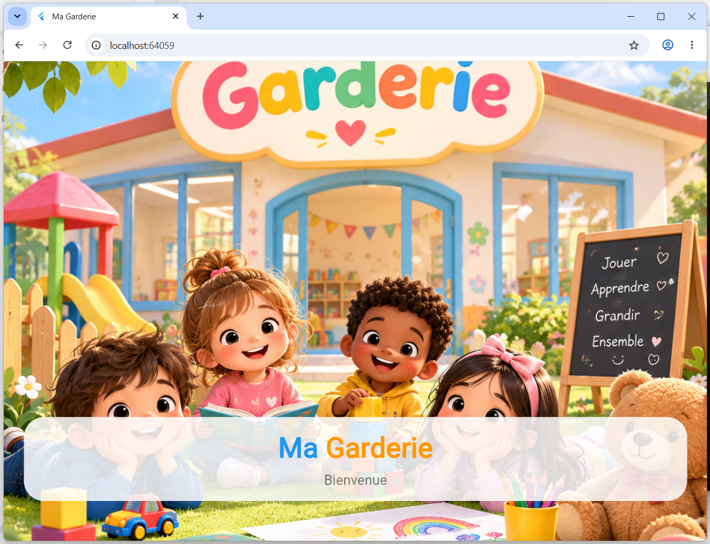
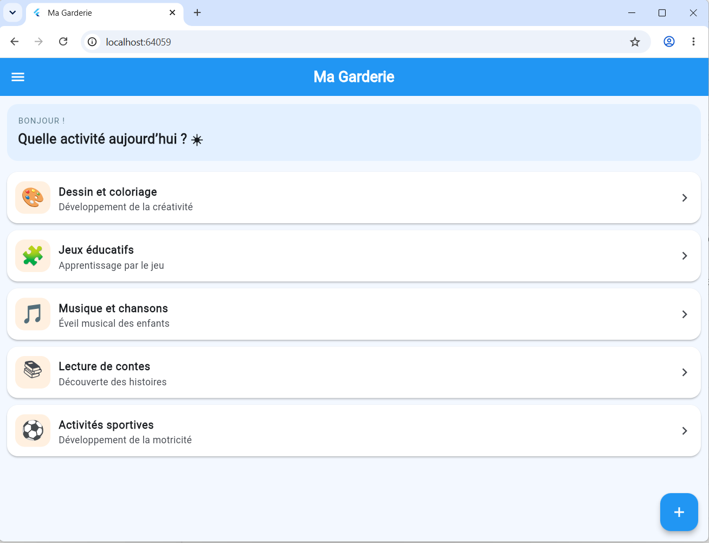
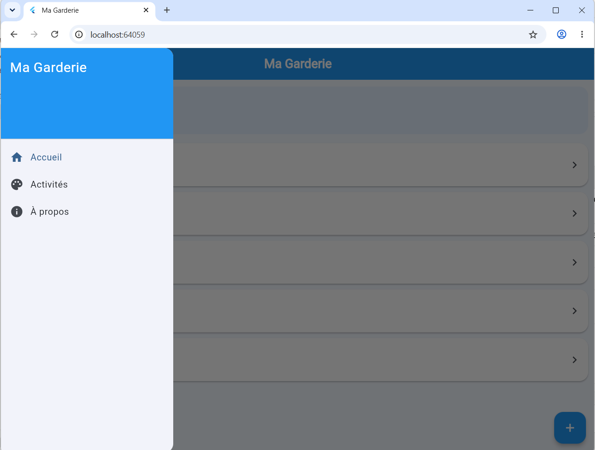
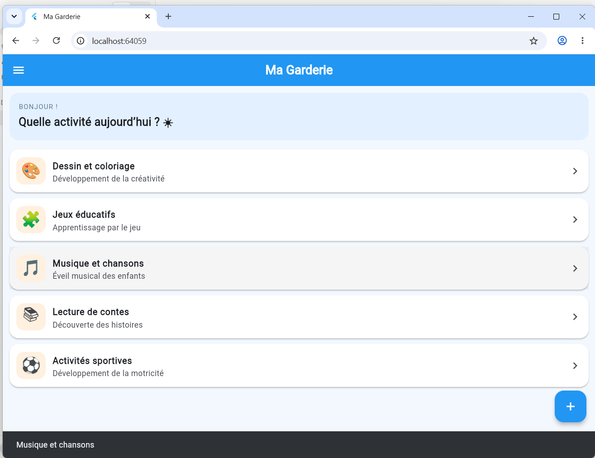

# Ma Garderie

Application mobile développée avec Flutter pour une garderie d'enfants.
Elle affiche un écran de démarrage plein écran, une page principale avec un
menu latéral, et la liste des activités proposées aux enfants.

## Fonctionnalités

- Splash Screen avec image d'accueil en plein écran et transition
  automatique vers la page principale après 3 secondes
- Page principale avec AppBar, Drawer (Accueil, Activités, À propos) et
  bouton flottant `+`
- Liste des activités (icône, titre, description) affichée dans des cartes
- Interactions : message « Nouvelle activité » au clic sur `+`, titre de
  l'activité dans un SnackBar au clic sur une carte, entrées du Drawer
  sélectionnables

## Technologies utilisées

- Flutter / Dart
- Git et GitHub (une branche par fonctionnalité)

## Installation et exécution

1. Installer Flutter : https://docs.flutter.dev/get-started/install
2. Cloner le dépôt :
```bash
   git clone https://github.com/hadhemi0905/garderie-mobile.git
```
3. Aller dans le dossier :
```bash
   cd garderie-mobile
```
4. Installer les dépendances :
```bash
   flutter pub get
```
5. Lancer l'application (émulateur ou appareil connecté) :
```bash
   flutter run
```

## Captures d'écran

### Splash Screen


### Page principale avec la liste des activités


### Drawer ouvert


### Message affiché après une interaction


## Organisation Git

Chaque étape a été développée dans une branche séparée, puis fusionnée
dans `main` : `feature/init-project`, `feature/splash-screen`,
`feature/home-page`, `feature/list-view`, `feature/interactions`,
`feature/design-update` et `docs/readme`.